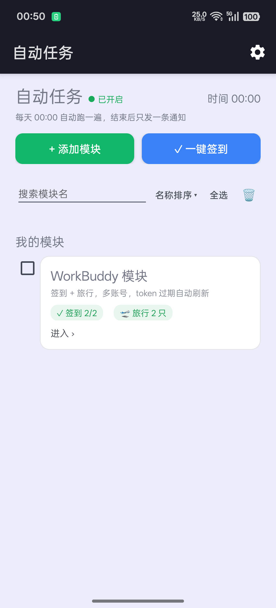
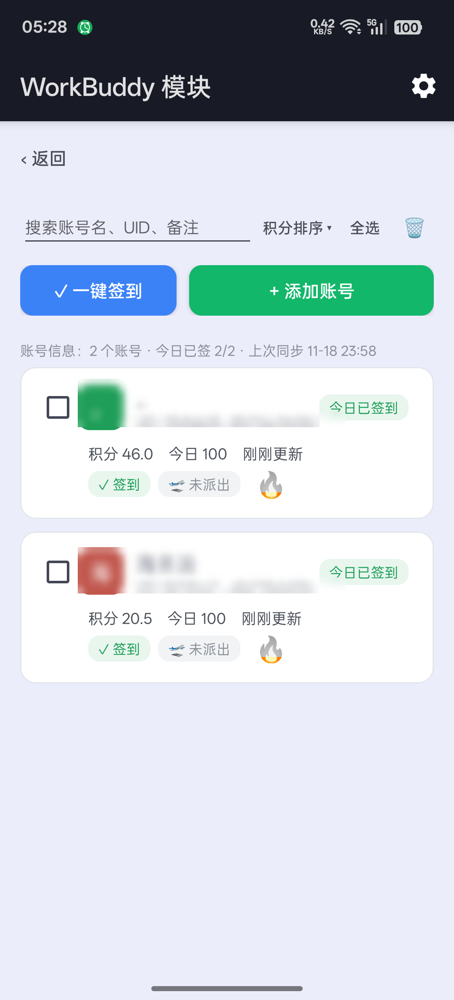

# 自动任务（AutoTask）

安卓上的「定时器」小工具：每天到点自动把 **WorkBuddy 签到 / 派猫猫旅行 / 活跃上报** 跑一遍，跑完只给你发一条通知。
不用常驻后台、不用看广告、不开 App 也能跑。

---

## 下载

点右边 → [`AutoTask.apk`](AutoTask.apk) → 页面上的 **Download raw file** 按钮。
（文件约 85 KB，Android 7.0 以上都能装。）

## 安装

1. 手机点开下载好的 APK，允许「安装未知应用」。
2. 打开 App，允许**通知**权限。
3. 点右上角 ⚙ → **开启**。开启时会做一次自检，2 分钟后收到一条「后台自检通过」通知，就说明不开 App 也能按时跑。
   > 国产 ROM 建议再补三件事（App 自己开不了）：允许**自启动**、电池优化设为**不限制**、**应用速冻 / 深度睡眠**里把 AutoTask 排除。
   > 三件事都不做也能跑 —— 只是会从「准点跑」变成「晚一点补跑」，见下面「到点了没收到通知？」。

---

## 怎么用

### 1. 首页



- 标题旁边 `● 已开启 / ● 已关闭` 是**总开关**，点右上角 ⚙ 切换。关掉后一条闹钟都不排，只能手动跑。
- `上次运行` 只显示主结论（如 `WorkBuddy 模块：2/2 账号，均已签`），旅行/活跃的明细在通知和 `run.log` 里，避免模块一多这一行就撑爆。
- 右上 `时间 00:00 · 09:00 · 21:00`：点一下改时间，保存即生效。**支持多个时段**，用逗号隔开（`0400` 或 `04:00` 都认），到点各跑一遍。
- **✓ 一键签到**：立刻把**勾选**的模块跑一遍（没勾会提示你先勾）。
- 卡片右下 `进入 ›`：进模块设置。
- 长按卡片 = 只跑这一个模块（隐藏手势，自测用）。

### 2. 模块页



- **+ 添加账号**：走浏览器登录。**请选「手机号 + 验证码」**，微信/QQ/邮箱登录常常拿不到账号信息。
  登录完返回 App，账号会自动补上（不用重新进）。
- **✓ 一键签到**：只签**勾选**的账号；签完卡片当场刷新，不用重启。
- 卡片上三行分别是：**可用积分** / **今日获得** / 更新时间；右边绿药丸是今天签没签。
- `[✓ 签到]`、`[🛫 旅行中]` 都能点 —— 点旅行会弹出这个号当前在哪、几点到、能拿多少积分。
- 旅行药丸右边的 **🔥** 是活跃度：**本月活跃天数 ÷ 当月天数**，从底部慢慢往上填，灰 → 红。**长按（或点一下）** 弹明细：今日活跃分、本月活跃 N/30 天、连续活跃、补签卡。
  首页模块卡片上还有一个 🔥，那是**所有账号合计**：`各账号本月活跃天数之和 ÷（账号数 × 当月天数）`，2 个号就是 60 天满，点一下看每个号的明细。
- 跑的时候对应卡片会转圈：首页哪张模块卡在跑就在标题右边转，账号页哪个号在跑就在徽章左边转。
- 搜索框按名字 / UID 过滤；`积分排序 ▾` 按积分从高到低；`全选` + 🗑 批量删账号。
- 想改显示名：**点一下账号名**，输入新名字保存。

---

## 常见问题

**到点了没收到通知？**

先说结论：**大概率那次已经补跑了**，先看首页「上次运行」。

ColorOS / MIUI 这类系统在 App 长时间退到后台（约 6 小时以上）后会把整个进程**冻结**。此时闹钟到点系统确实醒了，但进程刚起来就被冻回去，模块一行都没跑 —— 而且**系统不会给任何回调说"这次没跑成"**。这正是 11-22 00:00 那次丢单的真实原因（系统统计里 3 次唤醒总共只消耗 384 ms，`run.log` 整段空白）。

现在的处理是「不赌闹钟一定成功」，改成三个通道互相兜底：

| 通道 | 触发时机 | 说明 |
|------|----------|------|
| 主闹钟 | 准点 | 闹钟直接拉起前台服务（`getForegroundService`），不经广播那一跳，绕开后眼前台服务启动限制 |
| 备用闹钟 | 准点 + 10 分钟 | 主通道被冻结吞掉时补一次 |
| 看门狗 | 每 30 分钟 | JobScheduler 持久任务，发现「最近时段没跑过」直接补跑 |
| 打开 App | 任意时刻 | 进首页发现漏跑就自动补跑，不用再手动点「一键签到」 |

同一个时段只会**真跑一次**（`SlotGuard` 按时段去重），所以最坏情况是「晚 10~30 分钟」，不会再出现整天漏跑。

如果连补跑都没有（首页「上次运行」还是很久以前），按这三步查：

1. 标题旁有没有 `● 已开启`（关着就不会排闹钟）。
2. 系统里给「**自启动**」和「**允许后台运行 / 电池不限制**」——这是最关键的一条。App 被完全退出后，系统要靠这条才肯让它被闹钟叫醒；不开的话到点会被系统拦掉（ColorOS 的日志里就是 `OplusAppStartupManager: prevent start`）。
3. 进 App 首页看有没有红色横幅「⚠ 定时任务被系统拦了」——出现就说明闹钟被抹了，点它直接跳到应用设置去开自启动。

App 不需要常驻后台，跑完会自己退出；ColorOS/MIUI 这类系统还会把闹钟窗口放宽到 1 小时，属正常。

**签到报「活动未开启或已过期」（code 10001）？**
说明这个账号的凭据落到了旧活动上。删掉这个账号，用「手机号 + 验证码」重新登录一次即可。

**签到成功了，但「活跃地图」那一格还是不亮？**
签到和活跃是服务端的**两套账**：
- 签到打 `daily-checkin`，只影响 `checkin_dates` 和积分；
- 活跃地图看的是 `POST /v2/report` 上报的对话事件。

所以「签到成功但地图空白」是正常的，两件事互不影响。App 的活跃上报（每个账号连发 5 条）
就是补这一块的；「连续活跃」断了也只会体现在活跃上，不影响签到。

**换手机 / 重装后账号没了？**
账号只存在本机，重装前先在原机上截图记下，或重新登录添加。

---

## 从源码构建

不需要 Android Studio，也没有 Gradle：

```powershell
$env:JAVA_HOME    = 'C:\path\to\jdk-17'
$env:ANDROID_HOME = 'C:\path\to\Android\Sdk'   # 需要 build-tools;34.0.0 + platforms;android-34
powershell -NoProfile -ExecutionPolicy Bypass -File .\build.ps1
```

产物是根目录的 `AutoTask.apk`。首次构建会自动生成签名密钥 `signkey.p12`（已在 `.gitignore` 里，别提交；
换机器重新生成会导致签名变化，覆盖安装会失败，需要先卸载旧版）。

代码结构：

```
app/src/com/fz/autotask/
├── MainActivity.java        两个页面（首页 / 模块页）全部在这里
├── FlameView.java           活跃度火焰（emoji 🔥 + 按进度裁剪，从底部填）
├── core/                    宿主：AlarmScheduler 排闹钟、Runner 跑模块、Notifier 发通知、Config 存配置
│   ├── SlotGuard.java       时段槽去重 + 漏跑判定（闹钟/看门狗/打开 App 只真跑一次）
│   ├── RunLog.java          运行流水账（run.log，首页「上次运行」读它）
│   └── WatchdogJob.java     JobScheduler 看门狗：每 30 分钟补跑漏掉的时段 / 补排闹钟
└── modules/workbuddy/       WorkBuddy 模块：签到、旅行、活跃上报、OAuth 登录、账号模型
```

新增一个模块只要实现 `core/Module`（`id/name/description/run`）并在 `ModuleRegistry` 里注册一行。

「旅行」和「活跃」都是签到模块的**子任务**（在 `WorkBuddyModule.run()` 里串起来），不单独在首页出现，
也不单独发通知，会合并成一行：`WorkBuddy 模块：2/2 账号，均已签；旅行：…；活跃：…`
